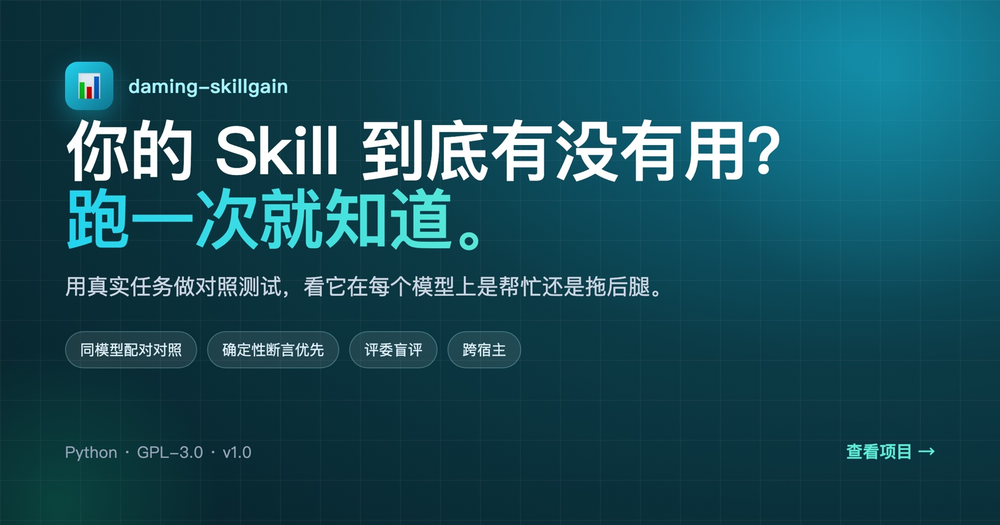

我是 Dylan，产品经理。我不会写代码——产品由 AI 实现，我负责想清楚做什么，以及判断它是否做好。

做的都是给 **AI Agent 用的基础设施**：让它有记忆、能成长，也让它的 Skill 能被检验到底有没有用。

## 正在做

写了几个 Skill，却说不清它们到底有没有帮上忙？同一个 Skill 换个模型可能从助力变成干扰。**daming-skillgain** 把 Skill 放进真实任务，与不启用时的产出对照，看它在每个模型上是帮忙还是拖后腿——用证据决定发布，还是关闭。

[查看项目 →](https://github.com/dylanma8232-art/daming-skillgain)

## 记忆与成长底座

Agent 裸奔运行会踩三个坑：上下文膨胀烧钱、越权执行失控、报错后陷入自我纠错死循环。**Daming-OS** 提供工业级的记忆与成长底座——三层语义缓存、防爆仓网关、安全沙箱安检、异常自愈闭环，不绑定任何特定框架。

[查看项目 →](https://github.com/dylanma8232-art/Daming-OS)

## 联系

[dylan.ma8232@gmail.com](mailto:dylan.ma8232@gmail.com) · 欢迎提 Issue 或 Star。
