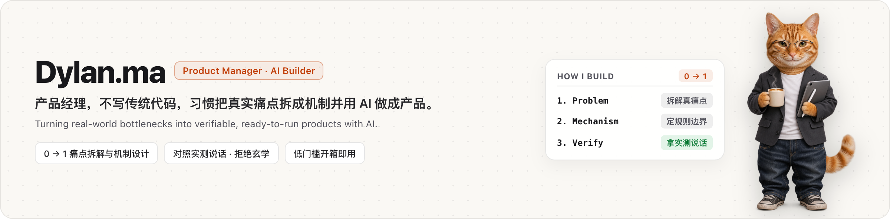

<picture>
  <source media="(prefers-color-scheme: dark)" srcset="assets/banner-dark.png">
  <source media="(prefers-color-scheme: light)" srcset="assets/banner-light.png">
  
</picture>

  
  
  
  

你好，我是 **Dylan**，一名不写传统代码的产品经理。

平时遇到不顺手的流程或缺乏抓手的问题，习惯先把真实痛点拆解成清晰的机制与验收标准，再借助 AI 做成能直接跑起来、经得起实测检验的产品。

---

## 开源项目 · Featured Projects

### [daming-skillgain](https://github.com/dylanma8232-art/daming-skillgain) — AI Agent Skill 质检门禁

<a href="https://github.com/dylanma8232-art/daming-skillgain">
  <picture>
    <source media="(prefers-color-scheme: dark)" srcset="assets/cards/card-skillgain-dark.png">
    <source media="(prefers-color-scheme: light)" srcset="assets/cards/card-skillgain-light.png">
    
  </picture>
</a>

告别凭感觉改提示词，通过同任务配对对照实测，一眼看清你的 Skill 在各模型上是真提效还是帮倒忙。 · **[进入仓库 →](https://github.com/dylanma8232-art/daming-skillgain)** · [English](https://github.com/dylanma8232-art/daming-skillgain/blob/main/README_EN.md)

 

### [Daming-OS](https://github.com/dylanma8232-art/Daming-OS) — 智能体记忆与自愈底座

<a href="https://github.com/dylanma8232-art/Daming-OS">
  <picture>
    <source media="(prefers-color-scheme: dark)" srcset="assets/cards/card-daming-os-dark.png">
    <source media="(prefers-color-scheme: light)" srcset="assets/cards/card-daming-os-light.png">
    
  </picture>
</a>

解决智能体健忘、上下文膨胀与报错死循环，让任意 Agent 低门槛接入长效记忆与安全自愈能力。 · **[进入仓库 →](https://github.com/dylanma8232-art/Daming-OS)** · [English](https://github.com/dylanma8232-art/Daming-OS/blob/main/README_EN.md)

 

### [DM-FH5-Telemetry](https://github.com/dylanma8232-art/DM-FH5-Telemetry) — 《极限竞速：地平线 5》副屏遥测与 AI 领航

<a href="https://github.com/dylanma8232-art/DM-FH5-Telemetry">
  <picture>
    <source media="(prefers-color-scheme: dark)" srcset="assets/cards/card-fh5-telemetry-dark.png">
    <source media="(prefers-color-scheme: light)" srcset="assets/cards/card-fh5-telemetry-light.png">
    
  </picture>
</a>

告别原厂遥测挡视线与玄学调车，把手机、平板或副屏变成实时赛车仪表台、动态拉力路书与 AI 调校师。 · **[进入仓库 →](https://github.com/dylanma8232-art/DM-FH5-Telemetry)** · [English](https://github.com/dylanma8232-art/DM-FH5-Telemetry/blob/main/README_EN.md)

---

## 做产品的习惯 · How I Build

- **从真实卡点出发**：只做自己在真实场景里反复遇到痛点、现有方案又不够顺手的东西，不堆概念型玩具。
- **拿实测代替感觉**：好不好用、改版有没有退化，优先交给对照实验和客观数据说话，不靠主观直觉放行。
- **低门槛闭环交付**：注重安全边界与开箱体验，尽量让人拿到手几步之内就能跑通并验证价值。

## 联系与交流 · Contact

- **Email**：[243909267+dylanma8232-art@users.noreply.github.com](mailto:243909267+dylanma8232-art@users.noreply.github.com) · **[查看全部仓库 →](https://github.com/dylanma8232-art?tab=repositories)**
